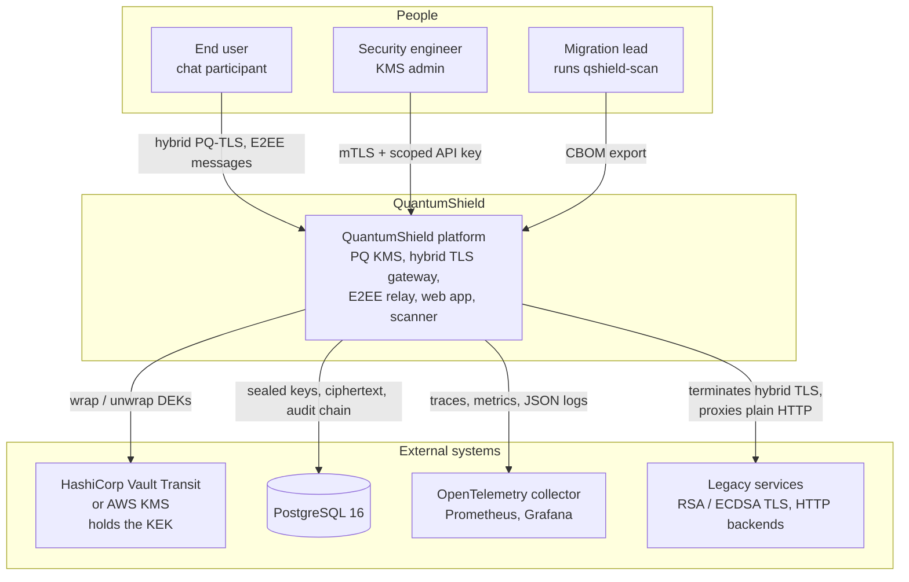
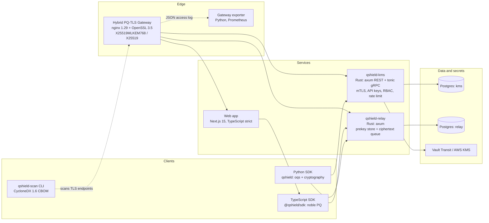
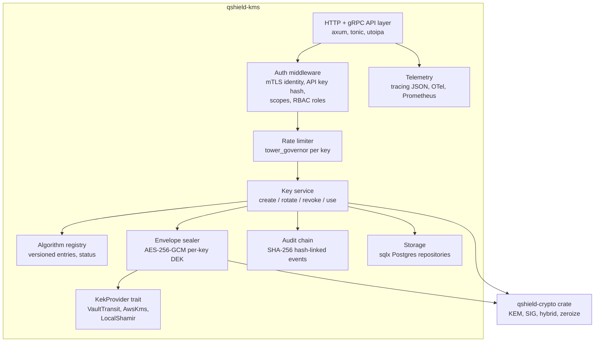
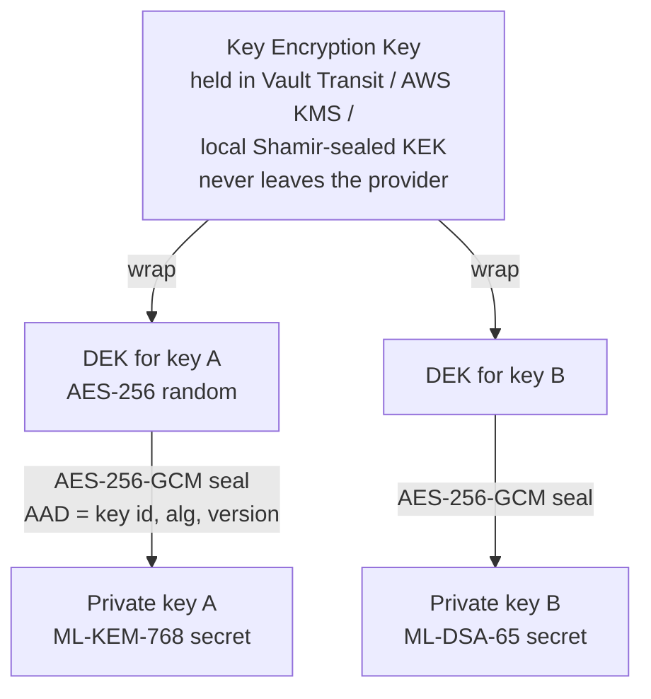
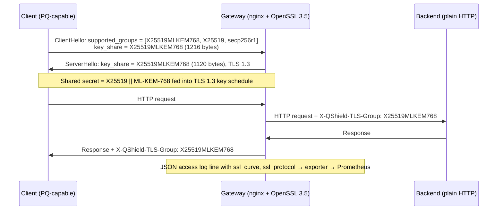
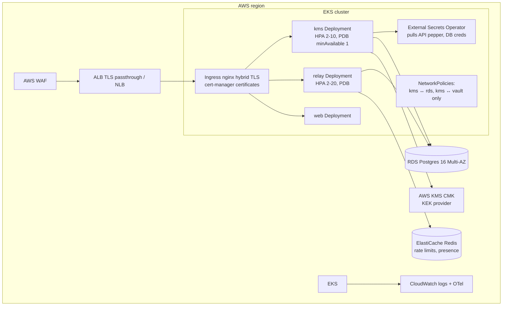

# QuantumShield Architecture

QuantumShield is a post-quantum (PQ) secure messaging and key-management platform built only on
NIST-standardized algorithms: **ML-KEM** (FIPS 203), **ML-DSA** (FIPS 204) and **SLH-DSA** (FIPS 205),
always combined with a classical algorithm in **hybrid mode** so that security never drops below
today's baseline if a PQ scheme is later broken.

This document is the single source of truth for the system design. It contains:

1. [Goals and non-goals](#1-goals-and-non-goals)
2. [Language and library choices (Rust vs Go)](#2-language-and-library-choices)
3. [C4 diagrams: context, containers, components](#3-c4-diagrams)
4. [Repository layout](#4-repository-layout)
5. [Cryptographic primitives and rationale](#5-cryptographic-primitives-and-rationale)
6. [Algorithm registry and crypto-agility](#6-algorithm-registry-and-crypto-agility)
7. [Key Management Service](#7-key-management-service-kms)
8. [Hybrid PQ-TLS gateway](#8-hybrid-pq-tls-gateway)
9. [End-to-end encrypted messaging: PQXDH and the hybrid ratchet](#9-end-to-end-encrypted-messaging)
10. [Relay server and data model](#10-relay-server)
11. [Client SDKs and interoperability](#11-client-sdks-and-interoperability)
12. [Crypto-inventory scanner and CBOM](#12-crypto-inventory-scanner-and-cbom)
13. [Observability](#13-observability)
14. [Deployment topology](#14-deployment-topology)
15. [Architecture decision records](#15-architecture-decision-records)

---

## 1. Goals and non-goals

### Goals

| # | Goal | How it is met |
|---|------|---------------|
| G1 | Make real services quantum-safe today | Hybrid TLS gateway (X25519MLKEM768) in front of any HTTP service; KMS that issues and operates PQ and hybrid keys; E2EE messaging that is PQ from the first message. |
| G2 | Never drop below the classical baseline | Every key exchange and signature is hybrid: X25519 + ML-KEM-768, Ed25519 + ML-DSA-65. A break of either component leaves the other intact (see §5.4). |
| G3 | Only vetted implementations | PQ primitives come from PQClean (via the `pqcrypto-*` Rust crates), liboqs (via the `oqs` Python bindings) and the audited `@noble/post-quantum` library for browsers. No lattice arithmetic is written in this repository. |
| G4 | Crypto-agility | Algorithms are versioned registry entries (`registry/algorithms.toml`). Adding or deprecating one is a config change plus a database migration, not a code rewrite (§6). |
| G5 | Launch-grade engineering | KATs against official NIST ACVP vectors, property and protocol tests, constant-time timing tests, SAST, SBOM, signed images, Helm/Terraform, observability, runbooks. |
| G6 | Tangible migration tooling | `qshield-scan` produces a CycloneDX 1.6 CBOM with a quantum-readiness score and per-asset migration advice. |

### Non-goals

* Replacing Signal or Matrix. The messaging product demonstrates a PQ-first protocol with a dumb
  relay; it is not a federated network.
* Hardware security modules. Private keys are sealed under a KEK held by HashiCorp Vault Transit or
  AWS KMS; an HSM-backed KEK provider is a straightforward extension of the `KekProvider` trait but
  is not shipped.
* Metadata privacy (sealed sender, traffic analysis resistance). The relay learns sender, recipient
  and timing. This is documented in `THREAT_MODEL.md`.

---

## 2. Language and library choices

### 2.1 Why Rust for the KMS and relay (not Go)

Both languages were evaluated against the requirements in the brief. Rust was chosen for the
services that touch private key material. The decisive factors:

| Requirement | Rust | Go | Verdict |
|-------------|------|----|---------|
| Vetted ML-KEM **and** ML-DSA **and** SLH-DSA | `pqcrypto-mlkem`, `pqcrypto-mldsa`, `pqcrypto-sphincsplus` wrap the PQClean reference and AVX2 implementations; `oqs` wraps liboqs. All three FIPS families covered. | Go 1.24 standard library ships ML-KEM only. ML-DSA/SLH-DSA need cgo + liboqs or third-party pure-Go code with limited review. | Rust |
| Memory zeroization of secrets | `zeroize` crate gives compiler-fenced wiping on drop; `Zeroizing<T>` wrappers make it hard to forget. | GC-managed memory cannot be reliably wiped; copies survive in heap/stack. | Rust |
| Constant-time primitives | `subtle` crate for CT equality/selection; dalek curves are CT by construction. | `crypto/subtle` exists but ecosystem CT discipline is weaker. | Rust |
| TLS 1.3 with client certificates (mTLS) | `rustls` + `axum-server`; no OpenSSL dependency at runtime. | `crypto/tls` is excellent. | Tie |
| gRPC + REST in one binary | `tonic` + `axum` share one tokio runtime and one `tower` middleware stack (auth, rate limiting, tracing). | `grpc-go` + `net/http`, equally good. | Tie |
| Performance of KEM/sign under load | Zero-cost FFI into PQClean C with AVX2. | cgo call overhead per op. | Rust |
| Operational simplicity (static binary, small image) | `FROM scratch`-style distroless images. | Same. | Tie |

Rust wins on the three properties that matter most for a key-management service: breadth of
vetted PQ implementations, deterministic zeroization, and constant-time discipline. The cost is a
slower build and a steeper learning curve, which is acceptable for a security-critical component.

### 2.2 Why Python and TypeScript for the clients

* The brief requires a pip-installable SDK and a browser SDK. Python uses `oqs` (liboqs) for
  ML-KEM/ML-DSA and `cryptography` (OpenSSL-backed) for X25519/Ed25519/AES-GCM/HKDF.
* The TypeScript SDK uses `@noble/post-quantum`, `@noble/curves`, `@noble/ciphers` and
  `@noble/hashes`. These are independently audited (Cure53, 2024/2025), pure-TypeScript, and run in
  browsers, Node and Deno. `liboqs-wasm` is **not** a published npm package; the closest option,
  `liboqs-node`, is a native addon that cannot run in a browser. The noble libraries are therefore
  the vetted browser implementation. This is recorded as ADR-004.
* The scanner is Python because the job is dominated by text parsing, X.509 parsing and TLS
  probing, which `cryptography` and the standard library cover well.

### 2.3 Why nginx + OpenSSL 3.5 for the gateway

OpenSSL 3.5 (April 2025, LTS) implements ML-KEM, ML-DSA, SLH-DSA and the IETF hybrid TLS groups
`X25519MLKEM768`, `SecP256r1MLKEM768` and `SecP384r1MLKEM1024` natively. The `oqs-provider` is
therefore no longer required for the hybrid groups the brief asks for, and using the upstream
implementation removes a third-party provider from the trust boundary. nginx 1.27+ exposes the
negotiated group as `$ssl_curve`, which the gateway forwards as a header and emits in its JSON
access log for metrics. This is ADR-003.

---

## 3. C4 diagrams

### 3.1 System context



### 3.2 Containers



### 3.3 Components inside `qshield-kms`



---

## 4. Repository layout

```
.
├── crates/
│   ├── qshield-crypto/      Algorithm registry, KEM/SIG wrappers, hybrid combiners, envelope
│   │                        sealing, zeroization, KATs, property tests, timing tests
│   ├── qshield-kms/         Key Management Service (REST + gRPC)
│   └── qshield-relay/       E2EE relay server (dumb ciphertext relay + prekey store)
├── proto/                   Protobuf definitions for the KMS gRPC API
├── registry/                algorithms.toml: the versioned algorithm registry
├── sdk/
│   ├── python/              `qshield` package: PQXDH, hybrid ratchet, relay client
│   └── typescript/          `@qshield/sdk`: same protocol for browsers and Node
├── tests/interop/           Cross-SDK vectors and the interop runner used in CI
├── scanner/                 `qshield-scan` CLI and CBOM generator
├── gateway/                 nginx configuration, exporter, handshake benchmark
├── web/                     Next.js 15 application (chat + KMS admin console)
├── deploy/
│   ├── docker/              Multi-stage Dockerfiles
│   ├── compose/             docker-compose for the 5-minute quickstart
│   ├── helm/                Helm chart (Deployment, HPA, PDB, NetworkPolicy, Ingress)
│   ├── k8s/                 Raw manifests and cert-manager / External Secrets resources
│   └── terraform/           AWS: VPC, EKS, RDS, ElastiCache, KMS, ALB, WAF, CloudWatch
├── observability/           Grafana dashboards (JSON), Prometheus rules, OTel collector config
├── loadtest/                k6 scripts and the committed report
├── showcase/hospital/       Quantum-Safe Hospital Messaging walkthrough
├── docs/                    API reference, benchmarks, timing results, migration guide
└── scripts/                 Repo tooling (threat-model reference sync, KAT trimming, demo)
```

---

## 5. Cryptographic primitives and rationale

### 5.1 Primitive inventory

| Purpose | Algorithm | Parameter | Source implementation | Why |
|---------|-----------|-----------|-----------------------|-----|
| PQ key encapsulation (default) | ML-KEM | 768 | PQClean via `pqcrypto-mlkem`; liboqs via `oqs`; noble | NIST level 3 (AES-192 equivalent). 1184-byte public key and 1088-byte ciphertext fit comfortably in TLS and messaging headers. Matches the IETF `X25519MLKEM768` TLS group and Signal's PQXDH choice. |
| PQ key encapsulation (high) | ML-KEM | 1024 | same | NIST level 5 for long-lived KMS keys that wrap data with multi-decade confidentiality needs. |
| PQ signatures (default) | ML-DSA | 65 | PQClean via `pqcrypto-mldsa`; liboqs; noble | Level 3, 1952-byte public key, 3309-byte signature. Fast verification, deterministic or hedged signing. Chosen for prekey and identity signatures where volume is high. |
| PQ signatures (high) | ML-DSA | 87 | same | Level 5 for root/CA style KMS keys. |
| PQ stateless hash signatures | SLH-DSA | SHA2-128s | PQClean via `pqcrypto-sphincsplus`; liboqs | Hash-based, conservative security assumption independent of lattices. "s" (small) variant: 7856-byte signature, 32-byte public key, slow signing. Used for low-volume, long-horizon signing such as release and firmware signing and the registry signing key. |
| Classical KEM / DH | X25519 | 256-bit | `x25519-dalek`; OpenSSL via `cryptography`; noble | Constant-time, widely deployed, the classical half of `X25519MLKEM768`. |
| Classical signatures | Ed25519 | 256-bit | `ed25519-dalek`; OpenSSL; noble | Deterministic, small, fast; the classical half of the hybrid signature. |
| AEAD | AES-256-GCM | 256-bit key, 96-bit nonce | `aes-gcm`; OpenSSL; noble | Required by the brief; hardware accelerated; 256-bit key keeps a margin against Grover-style speed-ups. Nonces are never reused: envelope sealing uses a fresh random nonce per seal, the ratchet derives key and nonce from a one-time message key. |
| KDF | HKDF-SHA256 | 256-bit | `hkdf` + `sha2`; OpenSSL; noble | Standard extract-and-expand; every call uses a distinct `info` string for domain separation (§5.5). |
| Hash chain / fingerprints | SHA-256, SHA-512 | | `sha2`; OpenSSL; noble | Audit chain and safety numbers. |
| API key hashing | BLAKE3 keyed hash | 256-bit | `blake3` | Fast, keyed with a server pepper so a database leak does not reveal usable keys. |
| Secret sharing | Shamir over GF(2^8) | 3-of-5 | `sharks` | Quorum unseal of the local KEK for disaster recovery. |

### 5.2 Why these parameter sets

* **ML-KEM-768 and ML-DSA-65 as defaults.** NIST level 3 is the industry consensus default (TLS
  hybrid groups, Signal PQXDH, Apple PQ3, Chrome, Cloudflare). Level 5 is offered for the KMS keys
  that protect other keys, because their compromise is catastrophic and their operation volume is
  low enough that the larger sizes do not matter.
* **SLH-DSA-SHA2-128s rather than 128f.** The "small" variant trades signing time (hundreds of
  ms) for a 7856-byte signature versus 17088 bytes. Our SLH-DSA use cases sign rarely and verify
  often, so small signatures win. SHA2 over SHAKE because SHA-2 hardware acceleration is ubiquitous.
* **AES-256-GCM, not ChaCha20-Poly1305.** The brief mandates AES-256-GCM. All targets have AES-NI
  or ARMv8 crypto extensions; the `aes-gcm` crate and OpenSSL use them.
* **HKDF-SHA256, not SHA-512.** 256-bit output is sufficient for 256-bit keys, and SHA-256 keeps the
  three SDKs byte-compatible with the smallest surface.

### 5.3 Hybrid key agreement

Every PQ key agreement is combined with X25519. The shared secret used by the application is

```
ss = HKDF-SHA256(salt = 0^32,
                 ikm  = ss_x25519 || ss_mlkem,
                 info = "QuantumShield-Hybrid-KEM-v1" || ct_x25519 || ct_mlkem || pk_x25519 || pk_mlkem,
                 L    = 32)
```

Both shared secrets and both ciphertexts (the X25519 ephemeral public key is its "ciphertext")
are bound into the KDF. This is the "dual-PRF" style combiner recommended in the IETF
`draft-ietf-tls-hybrid-design` and `draft-ounsworth-cfrg-kem-combiners` analyses: the result is
secure as long as **either** component KEM is secure, and the ciphertext binding prevents
mix-and-match attacks. The TLS gateway relies on OpenSSL's `X25519MLKEM768`, which concatenates
the two shared secrets into the TLS 1.3 key schedule, achieving the same property.

### 5.4 Hybrid signatures

A hybrid signature is the concatenation `sig_ed25519 (64 bytes) || sig_mldsa65 (3309 bytes)`
over the **same** message, prefixed with a domain-separation label. Verification requires both
signatures to be valid. Forgery therefore requires breaking Ed25519 **and** ML-DSA-65. A hybrid
public key is `pk_ed25519 (32) || pk_mldsa65 (1952)`.

### 5.5 Domain separation

Every KDF, signature and hash has a fixed ASCII label so that a value derived in one context can
never be confused with another:

| Context | Label |
|---------|-------|
| Hybrid KEM combiner | `QuantumShield-Hybrid-KEM-v1` |
| Hybrid signature prefix | `QuantumShield-Hybrid-SIG-v1` |
| PQXDH shared key | `QuantumShield_PQXDH_v1_X25519_MLKEM768_SHA256` |
| Ratchet root KDF | `QuantumShield_Ratchet_RK_v1` |
| Ratchet message key expansion | `QuantumShield_Ratchet_MK_v1` |
| Signed prekey signature | `QS-SPK-v1` |
| One-time prekey signature | `QS-OPK-v1` |
| Envelope AAD | `qshield-envelope-v1` plus key id, algorithm id and version |
| Audit chain event hash | `qshield-audit-v1` |
| Safety number | `QS-Fingerprint-v1` |

---

## 6. Algorithm registry and crypto-agility

`registry/algorithms.toml` is the canonical list of algorithms the platform knows about. Each entry
is immutable once published; a change in parameters is a new entry with a new identifier.

```toml
[[algorithm]]
id            = "ml-kem-768"
version       = 1
family        = "kem"
standard      = "FIPS 203"
nist_level    = 3
status        = "active"          # active | deprecated | disabled
hybrid_with   = "x25519"
public_key_len = 1184
secret_key_len = 2400
ciphertext_len = 1088
shared_secret_len = 32
implementation = "pqclean"        # recorded in the CBOM
introduced    = "2026-11-03"
```

Status semantics are enforced in one place (the `Registry` type in `qshield-crypto`):

| Status | Generate new keys | Use existing keys (decaps/verify/sign) | Rotate into |
|--------|-------------------|----------------------------------------|-------------|
| `active` | yes | yes | yes |
| `deprecated` | **no** | yes (decrypt/verify only; signing refused) | no |
| `disabled` | no | no | no |

Deprecating an algorithm is therefore:

1. Edit the TOML entry status (`active` → `deprecated`) and set `deprecated = "<date>"`.
2. Add a SQL migration that marks existing keys with that algorithm `rotation_required = true`
   (`crates/qshield-kms/migrations/`). The sample migration `0003_deprecate_ml_kem_512.sql` does
   exactly this for ML-KEM-512, and an integration test proves that after the migration the KMS
   refuses to create ML-KEM-512 keys, still decapsulates with existing ones, and flags them for
   rotation.
3. The web console's quantum-readiness score counts `deprecated` keys as exposure.

Algorithm identifiers appear in every stored key record, every ciphertext envelope, every CBOM
entry and every wire-format header, so a new algorithm can be introduced without touching parsers:
unknown identifiers are rejected explicitly rather than guessed.

---

## 7. Key Management Service (KMS)

### 7.1 Key hierarchy and envelope encryption



* Every private key gets its own random 256-bit DEK. The DEK seals the private key with
  AES-256-GCM using a fresh 96-bit nonce and AAD that binds key id, algorithm id and key version,
  so a sealed blob cannot be swapped between records.
* The DEK is wrapped by the KEK provider (`KekProvider` trait):
  * `VaultTransitKek`: `transit/encrypt/<key>` and `transit/decrypt/<key>` (Vault performs
    AES-256-GCM96 wrapping; the KEK never leaves Vault; key versions enable KEK rotation via
    `transit/rewrap`).
  * `AwsKmsKek`: `Encrypt`/`Decrypt` with an AWS KMS CMK and encryption context.
  * `LocalShamirKek`: a 256-bit KEK that exists only in process memory after a 3-of-5 Shamir
    unseal (`POST /v1/unseal`). Used for development, tests and air-gapped disaster recovery.
* Private keys are held in `Zeroizing<Vec<u8>>` and wiped on drop. `Debug` and `Display` for every
  secret type print `[REDACTED]`. A dedicated test drives every API path and scans every response,
  error and log line for 16-byte windows of any generated secret key (`leak_scan` test).

### 7.2 API surface

REST (OpenAPI 3.1, generated by `utoipa`, served at `/openapi.json`) and gRPC (`proto/kms.proto`)
expose the same operations:

| Operation | REST | gRPC | Scope |
|-----------|------|------|-------|
| Create key | `POST /v1/keys` | `KeyService.CreateKey` | `keys:create` |
| List / get | `GET /v1/keys`, `GET /v1/keys/{id}` | `ListKeys`, `GetKey` | `keys:read` |
| Export public key | `GET /v1/keys/{id}/public` | `GetPublicKey` | `keys:read` |
| Rotate | `POST /v1/keys/{id}/rotate` | `RotateKey` | `keys:rotate` |
| Revoke | `POST /v1/keys/{id}/revoke` | `RevokeKey` | `keys:revoke` |
| Encapsulate / decapsulate | `POST /v1/keys/{id}/encapsulate`, `.../decapsulate` | `CryptoService.Encapsulate`, `Decapsulate` | `crypto:kem` |
| Sign / verify | `POST /v1/keys/{id}/sign`, `.../verify` | `Sign`, `Verify` | `crypto:sign`, `crypto:verify` |
| Registry | `GET /v1/registry/algorithms` | `RegistryService.ListAlgorithms` | any |
| Audit | `GET /v1/audit/events`, `GET /v1/audit/verify` | `AuditService.*` | `audit:read` |
| Unseal | `POST /v1/unseal` | | mTLS admin cert only |
| Health, metrics | `GET /healthz`, `GET /readyz`, `GET /metrics` | | none |

### 7.3 Authentication and authorization

1. **mTLS.** The listener requires a client certificate issued by the deployment's internal CA
   (rustls `WebPkiClientVerifier`). The certificate's SAN identifies the calling workload.
2. **API keys.** Format `qsk_<key id>.<32 random bytes base64url>`. The server stores
   `BLAKE3_keyed(pepper, secret)`; comparison is constant-time. Keys carry an explicit scope set and
   an optional expiry.
3. **RBAC.** Roles are named scope bundles: `admin` (all), `operator` (keys:*, crypto:*),
   `app` (crypto:*, keys:read), `auditor` (keys:read, audit:read). A request must satisfy both the
   mTLS identity policy and the API key scope.
4. **Rate limiting.** `tower_governor` keyed by API key id: token bucket, defaults 50 req/s burst 100,
   configurable per key. Exceeding returns `429` with `Retry-After`.

### 7.4 Hash-chained audit log

Every key operation appends an event:

```
hash_n = SHA-256("qshield-audit-v1" || hash_{n-1} || canonical_json(event_n))
```

`hash_0` is 32 zero bytes. Events are inserted in the same database transaction as the operation
they describe, so an operation without an audit record cannot exist. `GET /v1/audit/verify`
recomputes the chain and reports the first break, if any. The table has no UPDATE or DELETE grants
for the service role (enforced in the migration).

---

## 8. Hybrid PQ-TLS gateway



* `ssl_protocols TLSv1.3;` only. `ssl_ecdh_curve X25519MLKEM768:X25519:secp256r1;` so hybrid is
  preferred but classic clients negotiate X25519 or P-256.
* The negotiated group is exposed per connection in the `X-QShield-TLS-Group` response header, in
  the upstream request header, and as the `group` label on
  `qshield_gateway_handshakes_total` and `qshield_gateway_handshake_seconds`.
* Downgrade resistance: a MITM cannot strip `X25519MLKEM768` from the ClientHello without
  breaking the TLS 1.3 transcript hash, which is bound into the Finished MACs. The test
  `gateway/bench/test_downgrade.mjs` demonstrates this by replaying a modified ClientHello and
  observing the handshake fail. A `strict` gateway profile additionally refuses connections that
  negotiate a classical group.
* Benchmarks (`docs/BENCHMARKS.md`) are produced by `gateway/bench/handshake_bench.mjs`, which uses
  Node 24's OpenSSL 3.5 TLS stack to measure handshake latency and bytes for `X25519` versus
  `X25519MLKEM768` against the same server.

---

## 9. End-to-end encrypted messaging

### 9.1 Key material per device

| Key | Algorithm | Lifetime | Published to relay |
|-----|-----------|----------|--------------------|
| `IK_dh` identity DH key | X25519 | device lifetime | public |
| `IK_sig` identity signing key | Ed25519 + ML-DSA-65 (hybrid) | device lifetime | public |
| `SPK` signed prekey | X25519 | rotated weekly | public + hybrid signature |
| `PQSPK` last-resort PQ prekey | ML-KEM-768 | rotated weekly | public + hybrid signature |
| `OPK_i` one-time prekeys | X25519 | consumed once | public + hybrid signature |
| `PQOPK_j` one-time PQ prekeys | ML-KEM-768 | consumed once | public + hybrid signature |

Signatures use the hybrid scheme of §5.4 with labels `QS-SPK-v1` and `QS-OPK-v1`, covering the
prekey id and public key. Signal signs only PQ one-time prekeys; QuantumShield signs all of them,
which costs 3.4 KB per prekey on upload but removes an attack surface for the relay to substitute
unsigned classical prekeys.

### 9.2 PQXDH session establishment

```mermaid
sequenceDiagram
    participant A as Alice
    participant R as Relay
    participant B as Bob
    B->>R: register IK_B, SPK_B+sig, PQSPK_B+sig, batches of OPK/PQOPK+sig
    A->>R: GET bundle(Bob)
    R->>R: tx: DELETE one OPK and one PQOPK ... RETURNING (consumed exactly once)
    R->>A: IK_B, SPK_B, PQSPK_B, OPK_B?, PQOPK_B? with signatures
    A->>A: verify all hybrid signatures with IK_sig_B
    A->>A: EK_A ← X25519 keygen
    A->>A: DH1=DH(IK_A,SPK_B) DH2=DH(EK_A,IK_B) DH3=DH(EK_A,SPK_B) DH4=DH(EK_A,OPK_B)
    A->>A: (CT, SS) ← ML-KEM-768.Encaps(PQOPK_B or PQSPK_B)
    A->>A: SK = HKDF(0xFF^32 || DH1||DH2||DH3||[DH4]||SS, info=PQXDH label)
    A->>A: AD = IK_A_pubs || IK_B_pubs ; init ratchet(SK, DHr=SPK_B, KEMr=PQSPK_B)
    A->>R: InitialMessage{IK_A, EK_A, ids, CT, ratchet msg 0}
    R->>B: deliver
    B->>B: recompute DH1..DH4 and SS = Decaps(PQOPK_B or PQSPK_B, CT)
    B->>B: SK, AD ; init ratchet(SK, DHs=SPK_B, KEMs=PQSPK_B)
    B->>B: decrypt msg 0 ; delete OPK_B and PQOPK_B private keys
```

Differences from Signal's PQXDH specification, and why:

* Identity signatures are hybrid Ed25519 + ML-DSA-65 instead of XEdDSA, so an attacker with a
  quantum computer cannot forge prekey bundles (Signal accepts this risk for now; the brief does
  not).
* The AD binds both parties' full identity public keys (DH and signing), not just the DH keys.
* `0xFF^32` prefix and the PQXDH label follow the specification exactly so the KDF input is
  never confusable with other protocol KDFs.

### 9.3 Hybrid Double Ratchet

The symmetric-key and Diffie-Hellman ratchets are the standard Signal Double Ratchet. The PQ
addition is a **KEM ratchet that runs in lock-step with the DH ratchet**, in the style of Apple's
PQ3: every time a party starts a new sending chain it encapsulates to the peer's most recent
ML-KEM-768 public key and mixes the shared secret into the root KDF together with the DH output.

```mermaid
sequenceDiagram
    participant A as Alice
    participant B as Bob
    Note over A: state: RK, DHs, DHr, KEMs, KEMr, CKs, CKr, Ns, Nr, PN, skipped
    A->>A: new chain: DHs ← X25519 keygen, KEMs ← ML-KEM keygen
    A->>A: (ct, ss) ← Encaps(KEMr) ; RK,CKs ← HKDF(salt=RK, DH(DHs,DHr) || ss)
    A->>B: header{v, flags, pn, n, dh_pub, kem_pub, kem_ct} || AES-256-GCM(mk, msg, aad=AD||header)
    B->>B: new DHr → skip keys up to pn ; ss ← Decaps(KEMs.sk, kem_ct)
    B->>B: RK,CKr ← HKDF(RK, DH(DHs,DHr) || ss)   (receiving chain)
    B->>B: DHs ← keygen, KEMs ← keygen, (ct', ss') ← Encaps(kem_pub_A)
    B->>B: RK,CKs ← HKDF(RK, DH(DHs,DHr) || ss')   (sending chain)
    B->>A: header{..., dh_pub_B, kem_pub_B, kem_ct'} || ciphertext
```

Properties:

* **Forward secrecy.** Message keys are deleted after use; chain keys are ratcheted by HMAC and
  the previous value discarded. Compromise of the current state does not reveal past message keys
  (protocol test `test_forward_secrecy`).
* **Post-compromise security.** One full round trip performs two DH ratchet steps **and** two KEM
  encapsulations with fresh keys, so an attacker who copied the state loses access once the honest
  parties exchange a message pair (`test_post_compromise_security`). The KEM contribution means
  healing holds even against a quantum adversary who can compute X25519 discrete logs.
* **Out-of-order delivery.** Skipped message keys are cached, bounded to 1000 per chain gap and
  2000 total with FIFO eviction; a header that would require skipping more is rejected
  (`test_out_of_order`, `test_skip_limit`).
* **Replay rejection.** Each `(dh_pub, n)` is accepted once; a replayed message fails
  authentication because its message key has been deleted (`test_replay_rejected`).
* The `kem_pub` and `kem_ct` fields are repeated in every header of a sending chain so that a chain
  can be entered out of order. Cost: 1184 + 1088 bytes per message. This is a deliberate trade of
  bandwidth for simplicity and robustness; ADR-006 discusses the alternative (Signal's SPQR).

### 9.4 Wire formats

All integers are big-endian. Sizes are fixed by the algorithm identifiers in the registry.

```
RatchetHeader (v1)
  u8     version        = 0x01
  u8     flags          bit0 = kem_ct present
  u32    pn             messages in previous sending chain
  u32    n              index in current chain
  [32]   dh_pub         X25519 ratchet public key
  [1184] kem_pub        ML-KEM-768 public key of the sender
  [1088] kem_ct         ML-KEM-768 ciphertext (present iff flags.bit0)

RatchetMessage = RatchetHeader || AES-256-GCM(ciphertext || 16-byte tag)
  key, nonce = HKDF-SHA256(salt=0^32, ikm=mk, info="QuantumShield_Ratchet_MK_v1", L=44)
  aad        = AD || RatchetHeader

InitialMessage (PQXDH, v1)
  u8     version        = 0x01
  u8     flags          bit0 = opk_id present, bit1 = pqopk_id present
  [32]   ik_dh_A, [32] ik_ed_A, [1952] ik_mldsa_A
  [32]   ek_A
  u32    spk_id, u32 pqspk_id, [u32 opk_id], [u32 pqopk_id]
  [1088] kem_ct         PQXDH encapsulation
  RatchetMessage        first ratchet message
```

The relay carries messages as JSON `{ "to", "from", "type": "init" | "msg", "payload": base64 }`
and never parses `payload`.

### 9.5 Safety numbers

`fingerprint(party) = iterate_5200(SHA-512, "QS-Fingerprint-v1" || IK_dh || IK_ed || IK_mldsa || user_id)`
truncated and encoded as 30 decimal digits (Signal's construction). The displayed safety number is
the lexicographically sorted concatenation of both fingerprints (60 digits) and the QR code encodes
the two raw fingerprints plus version. Both SDKs implement it identically and the interop test
checks that they agree.

---

## 10. Relay server

The relay is intentionally dumb. It stores public prekey material and opaque ciphertext, and it
authenticates devices without learning anything about message content.

```mermaid
erDiagram
    USERS ||--o{ DEVICES : has
    DEVICES ||--o{ SIGNED_PREKEYS : publishes
    DEVICES ||--o{ ONE_TIME_PREKEYS : publishes
    DEVICES ||--o{ MESSAGES : receives
    USERS { uuid id PK; text handle UK; timestamptz created_at }
    DEVICES { uuid id PK; uuid user_id FK; bytea ik_dh_pub; bytea ik_ed_pub; bytea ik_mldsa_pub; timestamptz created_at; timestamptz revoked_at }
    SIGNED_PREKEYS { uuid device_id FK; int id; text kind "x25519|ml-kem-768"; bytea pub; bytea sig; timestamptz created_at; bool active }
    ONE_TIME_PREKEYS { uuid device_id FK; int id; text kind; bytea pub; bytea sig; timestamptz uploaded_at }
    MESSAGES { bigserial seq PK; uuid to_device FK; uuid from_device; text type; bytea payload; timestamptz created_at; timestamptz delivered_at }
```

* **Authentication.** A device requests a 32-byte challenge, signs
  `"QS-Relay-Auth-v1" || challenge || device_id` with its hybrid identity key, and receives a
  short-lived HMAC token. The relay verifies both Ed25519 and ML-DSA-65 signatures.
* **Exactly-once one-time prekeys.** Bundle fetch runs
  `DELETE FROM one_time_prekeys WHERE id = (SELECT id ... FOR UPDATE SKIP LOCKED LIMIT 1) RETURNING ...`
  inside a transaction. A concurrency test launches 64 parallel fetches against a pool of 10 keys
  and asserts 10 distinct keys were handed out and 54 callers fell back to the last-resort prekey.
* **Zero plaintext.** The integration suite sends messages with unique sentinel plaintexts and
  then dumps every row of every relay table, asserting no sentinel (or any ratchet secret) appears.
* **Prekey exhaustion DoS.** Per-device fetch rate limits, `qshield_relay_prekey_pool_depth`
  metric with an alert at < 20, and the last-resort `PQSPK` so service continues (with reduced
  forward secrecy for that session's first message) when the pool is empty.

---

## 11. Client SDKs and interoperability

Both SDKs implement §9 byte-for-byte. The interop harness (`tests/interop/`) runs in CI:

1. Python generates Bob's bundle; TypeScript (Alice) runs PQXDH and sends 5 messages, including
   out-of-order; Python decrypts all and replies; TypeScript decrypts the replies.
2. The same scenario with roles swapped.
3. Both SDKs compute the safety number for the same identity keys and must agree.
4. Both SDKs verify the same ACVP KAT subset to guarantee the PQ primitives agree with NIST.

Python: `pip install qshield` (package `sdk/python`, typed, `py.typed`). TypeScript:
`npm install @qshield/sdk` (ESM + CJS, `d.ts`, works in browsers via noble).

---

## 12. Crypto-inventory scanner and CBOM

`qshield-scan` has three scan modes and one output format:

| Mode | Input | What it finds |
|------|-------|---------------|
| `code` | directory | Crypto API usage across Python, Java, Go, Rust, JS/TS, C/C++, .NET; PEM keys and certificates; TLS configuration in nginx/Apache/HAProxy/Envoy; dependency manifests pinning crypto libraries |
| `image` | OCI/Docker tarball (`docker save`) or `image:tag` via the Docker CLI | Same rules applied to every layer, plus installed OpenSSL/GnuTLS/libgcrypt package versions |
| `tls` | `host:port` list | Negotiated protocol, cipher, key-exchange group (probing `X25519MLKEM768` separately), certificate key type/size and signature algorithm |

Output is a CycloneDX 1.6 BOM whose components are `cryptographic-asset` entries with
`cryptoProperties` (`assetType`, `algorithmProperties.primitive`, `parameterSetIdentifier`,
`nistQuantumSecurityLevel`, `oid`) and QuantumShield properties
`qshield:quantum_vulnerable`, `qshield:recommendation`, `qshield:evidence`. The
**quantum-readiness score** is `100 × Σ weight(safe assets) / Σ weight(all assets)` where key
exchange and signature assets weigh 3, symmetric/hash assets weigh 1 (AES-128 and SHA-1 count as
weakened, not broken), and deprecated registry algorithms count as vulnerable. The web console
renders the same score for the KMS inventory.

---

## 13. Observability

* **Logs.** `tracing` with JSON formatter; every log line carries `trace_id`, `span_id`,
  `service`, `version`. Secret types implement redacted `Debug`.
* **Traces.** OpenTelemetry via OTLP/gRPC to the collector; spans for every API call, DB query and
  KEK provider round trip.
* **Metrics.** Prometheus exposition at `/metrics`:
  `qshield_kem_op_seconds{alg,op}`, `qshield_sig_op_seconds{alg,op}`, `qshield_key_rotations_total`,
  `qshield_key_rotation_failures_total`, `qshield_relay_prekey_pool_depth{device}`,
  `qshield_relay_messages_total`, `qshield_gateway_handshakes_total{group}`,
  `qshield_gateway_handshake_seconds{group}`, `qshield_audit_chain_length`.
* **Dashboards and alerts.** `observability/grafana/*.json` and
  `observability/prometheus/rules.yaml` (prekey exhaustion, error rate, rotation failures,
  classical-only negotiation ratio).

---

## 14. Deployment topology



Terraform in `deploy/terraform` provisions VPC, EKS, RDS, ElastiCache, KMS, ALB, WAF and CloudWatch.
The Helm chart in `deploy/helm/quantumshield` deploys the services with HPA, PDB, NetworkPolicy,
Ingress (cert-manager) and External Secrets. `docker-compose` in `deploy/compose` gives the local
quickstart with Vault in dev mode, Postgres, the gateway, the relay, the KMS, the web app and the
observability stack.

---

## 15. Architecture decision records

| ADR | Decision | Status |
|-----|----------|--------|
| ADR-001 | Rust for KMS and relay (see §2.1) | Accepted |
| ADR-002 | PQClean via `pqcrypto-*` crates as the Rust PQ implementation; liboqs via `oqs` for Python | Accepted |
| ADR-003 | nginx + OpenSSL 3.5 native hybrid groups instead of oqs-provider | Accepted |
| ADR-004 | `@noble/post-quantum` for the browser SDK because `liboqs-wasm` does not exist on npm and `liboqs-node` is native-only | Accepted |
| ADR-005 | Hybrid signatures on **all** prekeys, binding both identity key sets into the PQXDH AD | Accepted |
| ADR-006 | PQ3-style lock-step KEM ratchet rather than Signal's SPQR. SPQR's erasure-coded chunking saves bandwidth but adds substantial state-machine complexity that would need its own formal analysis; the lock-step design reuses the Double Ratchet proofs with a KEM term added to the root KDF. Revisit when SPQR has a stable published specification. | Accepted |
| ADR-007 | Per-key DEK envelope with KEK in Vault Transit / AWS KMS; `LocalShamirKek` for DR | Accepted |
| ADR-008 | Hash-chained audit log in the same transaction as the operation | Accepted |
| ADR-009 | API keys hashed with keyed BLAKE3 and a server-side pepper | Accepted |
| ADR-010 | CycloneDX 1.6 `cryptographic-asset` components for the CBOM | Accepted |
