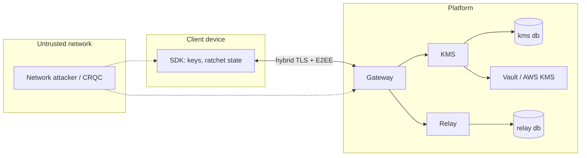

# QuantumShield Threat Model (STRIDE)

This document enumerates the threats QuantumShield defends against, maps each to a concrete
mitigation, and points at the code that implements it. Mitigation references use the form
`path:line`; they are kept exact by `scripts/threat_refs.py`, which reads `// TM:<id>` (Rust),
`# TM:<id>` (Python, YAML, nginx) and `// TM:<id>` (TypeScript) anchor comments in the source
tree and rewrites the line numbers below. CI runs `scripts/threat_refs.py --check` and fails if any
reference is stale or any anchor is missing.

## 1. Scope and assumptions

**In scope.** The KMS, the hybrid TLS gateway, the relay, the two client SDKs, the web
application, the scanner, the build and release pipeline, and the deployment manifests.

**Assumptions.**

* The endpoints (user devices, KMS clients) are not compromised at the time a session is
  established. Compromise after that point is in scope (post-compromise security).
* HashiCorp Vault / AWS KMS correctly protect the KEK. Compromise of the KEK provider is treated
  as total compromise of sealed keys and is mitigated operationally (quorum unseal, KEK rotation,
  audit).
* PostgreSQL enforces the privileges granted in the migrations.
* NIST-standardized algorithms at the chosen parameter sets are secure, **or** the classical
  components are secure; we do not assume both.

**Adversaries.**

| Adversary | Capability |
|-----------|------------|
| Network attacker (Dolev-Yao) | Read, modify, inject, replay, delay any network message; today or with a future cryptographically relevant quantum computer (CRQC). |
| Malicious relay | Full control of the relay process and database. |
| Insider with KMS API key | Holds a valid API key with some scope set. |
| Database thief | Offline copy of the KMS or relay database (backups, snapshots). |
| Device compromise | Full read of one device's memory and storage at one point in time. |
| Supply-chain attacker | Can publish a malicious version of a dependency or tamper with build artifacts. |
| Local side-channel attacker | Measures timing of decapsulation and signature operations on the same host. |

## 2. Trust boundaries

Boundaries: B1 device ↔ network; B2 gateway (TLS termination) ↔ services; B3 services ↔ databases;
B4 KMS ↔ KEK provider; B5 build pipeline ↔ registry/cluster.

## 3. STRIDE summary by component

| Component | Spoofing | Tampering | Repudiation | Information disclosure | Denial of service | Elevation of privilege |
|-----------|----------|-----------|-------------|------------------------|-------------------|------------------------|
| Gateway | T05 | T05, T06 | | T01 | T13 | |
| KMS | T07, T08 | T09, T10 | T10 | T02, T03, T11 | T13 | T08 |
| Relay | T04, T07 | T04, T06 | T10 | T01, T04 | T12 | |
| SDK / protocol | T04 | T06, T14 | | T01, T02, T11 | T12, T14 | |
| Build & supply chain | T15 | T15 | T15 | | | T15 |

## 4. Threat catalogue

Each threat lists: description, STRIDE category, affected component, mitigation(s) and the code
reference(s) that implement them. Status `verified` means an automated test exercises the
mitigation.

### T01 Harvest-now-decrypt-later

**Description.** An adversary records all traffic today and decrypts it once a CRQC exists. This
breaks every classical key exchange (RSA, ECDH, X25519) retroactively.
**STRIDE.** Information disclosure. **Boundary.** B1.

| Mitigation | Reference | Status |
|------------|-----------|--------|
| T01-M1 Hybrid TLS key exchange X25519MLKEM768 preferred at the gateway | `gateway/nginx/nginx.conf:1` | verified by `gateway/bench/handshake_bench.mjs` |
| T01-M2 PQXDH mixes an ML-KEM-768 shared secret into the session key from the first message | `sdk/python/qshield/pqxdh.py:1`, `sdk/typescript/src/pqxdh.ts:1` | verified by protocol tests |
| T01-M3 KEM ratchet refreshes PQ secrets on every DH ratchet step | `sdk/python/qshield/ratchet.py:1`, `sdk/typescript/src/ratchet.ts:1` | verified by `test_post_compromise_security` |
| T01-M4 KMS hybrid KEM combiner binds both shared secrets and ciphertexts | `crates/qshield-crypto/src/hybrid.rs:1` | verified by KATs and proptests |
| T01-M5 Scanner flags every classical key exchange and signature as quantum-vulnerable with a migration recommendation | `scanner/qshield_scan/rules.py:1` | verified by scanner tests |

### T02 Private key compromise at rest (database or backup theft)

**Description.** An attacker obtains the KMS database or a backup and tries to recover private keys.
**STRIDE.** Information disclosure. **Boundary.** B3.

| Mitigation | Reference | Status |
|------------|-----------|--------|
| T02-M1 Every private key is sealed with AES-256-GCM under a per-key DEK | `crates/qshield-crypto/src/envelope.rs:1` | verified |
| T02-M2 DEKs are wrapped by a KEK that never enters the database (Vault Transit / AWS KMS / Shamir-sealed) | `crates/qshield-kms/src/kek/mod.rs:1` | verified (local + Vault integration test) |
| T02-M3 AAD binds key id, algorithm and version so sealed blobs cannot be transplanted | `crates/qshield-crypto/src/envelope.rs:1` | verified by `envelope_rejects_swapped_aad` |
| T02-M4 Key material restore requires a 3-of-5 Shamir quorum | `crates/qshield-kms/src/kek/shamir.rs:1` | verified by `unseal_requires_threshold` |
| T02-M5 Backups are encrypted and restore is tested | `deploy/compose/backup/backup.sh:1`, `RUNBOOK.md` | verified by `scripts/test_restore.sh` in CI |

### T03 Private key leakage through logs, errors or API responses

**Description.** A secret key ends up in a log line, an error message, a panic, or a serialized
API response.
**STRIDE.** Information disclosure. **Boundary.** B2/B3.

| Mitigation | Reference | Status |
|------------|-----------|--------|
| T03-M1 Secret types implement redacted `Debug`/`Display` and zeroize on drop | `crates/qshield-crypto/src/secret.rs:1` | verified |
| T03-M2 API response types contain only public material by construction (no field can hold a secret key) | `crates/qshield-kms/src/api/types.rs:1` | verified |
| T03-M3 Leak-scan test drives every endpoint and scans all responses, errors and captured logs for 16-byte windows of every generated secret | `crates/qshield-kms/tests/leak_scan.rs:1` | verified |
| T03-M4 Python and TypeScript secret containers redact `repr`/`toString` and wipe on `destroy()` | `sdk/python/qshield/secret.py:1`, `sdk/typescript/src/secret.ts:1` | verified |

### T04 Malicious relay

**Description.** The relay operator reads, modifies, drops, reorders or injects messages, or
substitutes prekey bundles to man-in-the-middle a session.
**STRIDE.** Spoofing, tampering, information disclosure. **Boundary.** B1/B2.

| Mitigation | Reference | Status |
|------------|-----------|--------|
| T04-M1 End-to-end encryption; the relay stores only ciphertext and public prekey material | `crates/qshield-relay/src/store.rs:1` | verified by `zero_plaintext_in_db` |
| T04-M2 All prekeys carry hybrid Ed25519 + ML-DSA-65 signatures by the identity key; clients verify before use | `sdk/python/qshield/pqxdh.py:1`, `sdk/typescript/src/pqxdh.ts:1` | verified by `test_tampered_bundle_rejected` |
| T04-M3 Safety numbers let users verify identity keys out of band (numeric + QR) | `sdk/python/qshield/fingerprint.py:1`, `web/src/lib/fingerprint.ts:1` | verified by interop test |
| T04-M4 AEAD with AD binding both identities; modified ciphertext fails authentication | `sdk/python/qshield/ratchet.py:1` | verified by `test_tampered_ciphertext_rejected` |
| T04-M5 Replay rejected because message keys are single-use | `sdk/python/qshield/ratchet.py:1` | verified by `test_replay_rejected` |

### T05 Downgrade attack: hybrid → classical

**Description.** A MITM removes the hybrid group from the ClientHello so the connection falls back
to X25519, or a protocol-level attacker convinces an SDK to run classical-only PQXDH.
**STRIDE.** Tampering, spoofing. **Boundary.** B1.

| Mitigation | Reference | Status |
|------------|-----------|--------|
| T05-M1 TLS 1.3 transcript binding: any modification of supported_groups breaks the Finished MAC | `gateway/bench/test_downgrade.mjs:1` | verified (test shows tampered ClientHello aborts) |
| T05-M2 Strict gateway profile refuses classical groups when the deployment requires PQ | `gateway/nginx/strict.conf:1` | verified by config test |
| T05-M3 PQXDH has no classical-only mode: the ML-KEM ciphertext field is mandatory and bundles without a PQ prekey are rejected | `sdk/python/qshield/pqxdh.py:1`, `sdk/typescript/src/pqxdh.ts:1` | verified by `test_bundle_without_pq_prekey_rejected` |
| T05-M4 Negotiated group is surfaced to users (badge) and operators (metrics, alert on classical ratio) | `web/src/components/negotiation-badge.tsx:1`, `observability/prometheus/rules.yaml:1` | verified by UI test |

### T06 Message tampering, reordering and replay

**Description.** Network attacker modifies ciphertext or headers, reorders, or replays messages.
**STRIDE.** Tampering. **Boundary.** B1.

| Mitigation | Reference | Status |
|------------|-----------|--------|
| T06-M1 Header is AAD of the AEAD; any header change fails authentication | `sdk/python/qshield/ratchet.py:1` | verified |
| T06-M2 Skipped-key cache bounded (1000 per gap, 2000 total); larger gaps rejected | `sdk/python/qshield/ratchet.py:1`, `sdk/typescript/src/ratchet.ts:1` | verified by `test_skip_limit` |
| T06-M3 Out-of-order messages decrypt via cached skipped keys; delivered twice fails | `sdk/python/qshield/ratchet.py:1` | verified by `test_out_of_order` |

### T07 Spoofed clients (KMS and relay authentication)

**Description.** An attacker impersonates a KMS client or a messaging device.
**STRIDE.** Spoofing. **Boundary.** B2.

| Mitigation | Reference | Status |
|------------|-----------|--------|
| T07-M1 KMS requires mTLS with client certificates from the internal CA | `crates/qshield-kms/src/tls.rs:1` | verified by `mtls_rejects_no_client_cert` |
| T07-M2 KMS API keys are high-entropy, stored as keyed BLAKE3 hashes, compared in constant time | `crates/qshield-kms/src/auth.rs:1` | verified |
| T07-M3 Relay devices authenticate by hybrid-signing a fresh server challenge | `crates/qshield-relay/src/auth.rs:1` | verified by `auth_rejects_bad_signature` |

### T08 Privilege escalation through over-broad API keys

**Description.** A key scoped for one purpose is used for another (e.g., an `auditor` key creating
or exporting keys).
**STRIDE.** Elevation of privilege. **Boundary.** B2.

| Mitigation | Reference | Status |
|------------|-----------|--------|
| T08-M1 Every handler declares a required scope; the middleware enforces it before the handler runs | `crates/qshield-kms/src/auth.rs:1` | verified by `rbac_matrix` test over every role × endpoint |
| T08-M2 Roles are fixed scope bundles; custom scopes can only narrow a role | `crates/qshield-kms/src/auth.rs:1` | verified |
| T08-M3 Unseal is restricted to the admin mTLS identity, not API keys | `crates/qshield-kms/src/api/unseal.rs:1` | verified |

### T09 Tampering with stored keys or the algorithm registry

**Description.** An attacker with database write access modifies a sealed key, swaps algorithms, or
flips a deprecated algorithm back to active.
**STRIDE.** Tampering. **Boundary.** B3.

| Mitigation | Reference | Status |
|------------|-----------|--------|
| T09-M1 Envelope AAD binds key id, algorithm and version; modified records fail to open | `crates/qshield-crypto/src/envelope.rs:1` | verified |
| T09-M2 Registry is loaded from a file shipped with the binary/config and validated at startup; status transitions are only forward (active → deprecated → disabled) | `crates/qshield-crypto/src/registry.rs:1` | verified by `registry_rejects_reactivation` |
| T09-M3 Audit chain makes undetected modification of history infeasible | `crates/qshield-kms/src/audit.rs:1` | verified by `audit_chain_detects_tamper` |

### T10 Repudiation of key operations

**Description.** An operator denies having rotated, revoked or used a key; or an attacker deletes
audit records.
**STRIDE.** Repudiation. **Boundary.** B3.

| Mitigation | Reference | Status |
|------------|-----------|--------|
| T10-M1 Hash-chained append-only audit log written in the same transaction as the operation | `crates/qshield-kms/src/audit.rs:1` | verified |
| T10-M2 Service DB role has no UPDATE/DELETE on `audit_events` | `crates/qshield-kms/migrations/0001_init.sql:1` | verified by migration test |
| T10-M3 `GET /v1/audit/verify` recomputes the chain | `crates/qshield-kms/src/api/audit.rs:1` | verified |

### T11 Side channels on secret-dependent operations

**Description.** Timing differences in decapsulation (implicit rejection), signature generation or
key comparison leak secret bits.
**STRIDE.** Information disclosure. **Boundary.** host.

| Mitigation | Reference | Status |
|------------|-----------|--------|
| T11-M1 PQ primitives come from PQClean/liboqs implementations written to be constant-time; no secret-dependent branching is written in this repo | `crates/qshield-crypto/src/kem.rs:1` | verified by dudect-style tests |
| T11-M2 All secret comparisons use `subtle::ConstantTimeEq` / `hmac.compare_digest` / noble's CT equality | `crates/qshield-kms/src/auth.rs:1`, `sdk/python/qshield/ratchet.py:1` | verified |
| T11-M3 dudect-style timing tests for decapsulation and signing with committed results | `crates/qshield-crypto/benches/dudect.rs:1`, `docs/TIMING_RESULTS.md` | verified |
| T11-M4 Hybrid verification evaluates both signatures before deciding (no early exit on the classical result) | `crates/qshield-crypto/src/hybrid.rs:1` | verified |

### T12 Prekey exhaustion denial of service

**Description.** An attacker repeatedly fetches a target's bundle to drain one-time prekeys, forcing
weaker (last-resort) sessions or blocking new sessions.
**STRIDE.** Denial of service. **Boundary.** B2.

| Mitigation | Reference | Status |
|------------|-----------|--------|
| T12-M1 Per-requester and per-target rate limits on bundle fetch | `crates/qshield-relay/src/ratelimit.rs:1` | verified |
| T12-M2 Last-resort signed PQ prekey and signed prekey guarantee availability when the pool is empty | `crates/qshield-relay/src/store.rs:1` | verified by `bundle_falls_back_to_last_resort` |
| T12-M3 Pool depth metric and alert; SDK auto-replenishes when depth < threshold | `observability/prometheus/rules.yaml:1`, `sdk/python/qshield/client.py:1` | verified |
| T12-M4 Each one-time prekey is consumed exactly once even under concurrency | `crates/qshield-relay/src/store.rs:1` | verified by `otp_consumed_exactly_once_concurrent` |

### T13 Resource exhaustion of KMS and gateway

**Description.** Expensive operations (SLH-DSA signing, ML-DSA-87 keygen) are triggered in volume.
**STRIDE.** Denial of service. **Boundary.** B2.

| Mitigation | Reference | Status |
|------------|-----------|--------|
| T13-M1 Per-API-key token-bucket rate limiting | `crates/qshield-kms/src/ratelimit.rs:1` | verified |
| T13-M2 Request body size limits and timeouts | `crates/qshield-kms/src/main.rs:1` | verified |
| T13-M3 Horizontal scaling (HPA) and PDB in the Helm chart; k6 load test documents capacity | `deploy/helm/quantumshield/templates/hpa.yaml:1`, `loadtest/REPORT.md` | verified |

### T14 Protocol state corruption and malformed input

**Description.** Malformed headers, oversized skip counts, wrong-length keys, or bundle fields of the
wrong algorithm.
**STRIDE.** Tampering / DoS. **Boundary.** B1.

| Mitigation | Reference | Status |
|------------|-----------|--------|
| T14-M1 Strict fixed-size parsing of every wire format; lengths derived from registry constants | `sdk/python/qshield/wire.py:1`, `sdk/typescript/src/wire.ts:1` | verified by property tests |
| T14-M2 Wrong-key and tampered-ciphertext rejection across all parameter sets | `crates/qshield-crypto/tests/properties.rs:1` | verified |

### T15 Supply-chain compromise of crypto libraries and build artifacts

**Description.** A malicious dependency version, a tampered container image, or a compromised CI
runner introduces a backdoor.
**STRIDE.** All. **Boundary.** B5.

| Mitigation | Reference | Status |
|------------|-----------|--------|
| T15-M1 Lockfiles for Cargo, pip and npm; dependency scanning (cargo-audit, pip-audit, npm audit) fails CI on HIGH/CRITICAL | `.github/workflows/ci.yml:1` | verified |
| T15-M2 KATs against official NIST ACVP vectors run on every build; a swapped implementation that changes outputs fails CI | `crates/qshield-crypto/tests/kat.rs:1` | verified |
| T15-M3 SBOM generated with Syft; images signed with cosign (keyless, Sigstore); deployment verifies signatures | `.github/workflows/release.yml:1`, `deploy/k8s/policy/cosign-policy.yaml:1` | verified |
| T15-M4 SAST (Semgrep OWASP, cargo-audit/clippy, Bandit) and Trivy on images | `.github/workflows/ci.yml:1` | verified |
| T15-M5 Multi-stage distroless images with pinned base digests | `deploy/docker/kms.Dockerfile:1` | verified |

## 5. Residual risks

| Risk | Why accepted | Compensating control |
|------|--------------|----------------------|
| Relay learns metadata (who talks to whom, when, message sizes) | Sealed sender and padding are out of scope for this release | Documented; TLS to the relay hides metadata from the network attacker |
| Compromise of the KEK provider | Vault/AWS KMS are the trust anchor | Quorum unseal for the local provider, KEK rotation runbook, audit |
| A CRQC breaks ML-KEM **and** the classical component is also broken | Not defensible with current standards | Crypto-agility makes replacing a component a configuration change |
| Endpoint compromise before session setup | Out of scope for any E2EE protocol | Safety-number verification detects identity key substitution |
| Bandwidth cost of repeating `kem_pub` and `kem_ct` in every header (~2.3 KB) | Simplicity and out-of-order robustness | ADR-006; revisit with SPQR |
